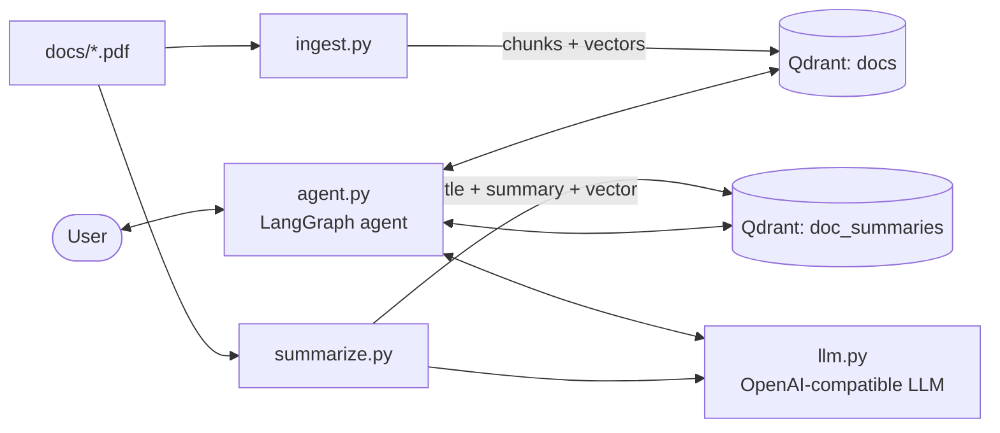
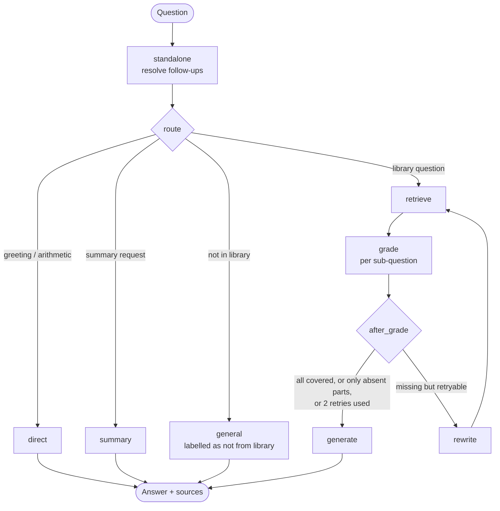
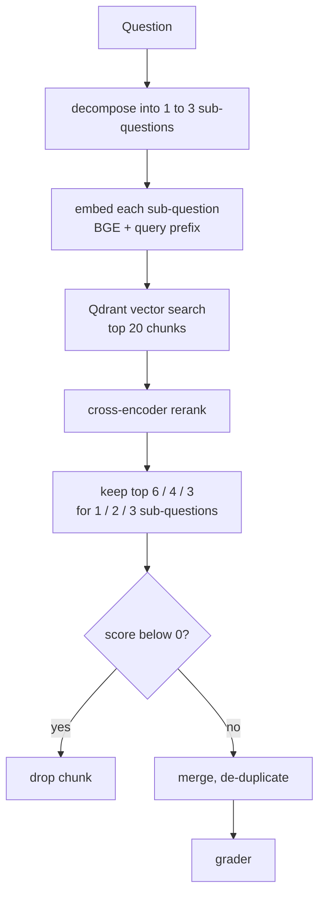

# Agentic RAG 

A question-answering agent for a local library of research-paper PDFs. It decides how to handle each message (chat, summary, library search, or general knowledge), splits multi-part questions, retrieves and reranks passages, checks whether they actually answer each part, retries with a rewritten query when they don't, and answers with page-level citations.

Built with LangGraph, Qdrant, BGE embeddings and a cross-encoder reranker. The LLM is any OpenAI-compatible endpoint (Groq by default).

## Features

- **Routing:** greetings and arithmetic, summary requests, library questions and out-of-library questions each take a different path.
- **Named-document summaries:** "Summarize 2611.30891" or "Summarize the AeroJEPA paper" is resolved by file name or title keyword, without the LLM router.
- **Query decomposition:** a question with several parts is split into at most 3 sub-questions, each searched separately.
- **Two-stage retrieval:** vector search (top 20) followed by cross-encoder reranking.
- **Per-part grading:** the grader marks each sub-question as covered or missing.
- **Retry loop:** missing parts that look findable are rewritten and searched again, up to 2 times.
- **Honest gaps:** parts that are not in the library are reported as such instead of guessed.
- **Citations:** every claim is cited as `(file.pdf, p.N)`, and the sources list only shows pages the answer actually cites.
- **Conversation memory:** follow-ups such as "What does it use that for?" are rewritten into standalone questions using the last 3 turns.
- **Prompt-injection guard:** retrieved text is wrapped in `<excerpt>` tags and the model is told to treat it as data only.
- **Resumable indexing:** ingestion and summarization skip files that are already done.

## Architecture

### System overview



### Agent graph



### Retrieval detail



## Project structure

```
.
├── docs/            PDF library (you add the files)
├── ingest.py        PDFs -> chunks -> embeddings -> Qdrant "docs"
├── summarize.py     PDFs -> title + summary -> Qdrant "doc_summaries"
├── agent.py         LangGraph agent and chat loop
├── llm.py           LLM client configuration
├── manifest.json    created by ingest.py (file hashes already indexed)
├── summaries.json   created by summarize.py (files already summarized)
└── .env             LLM_API_KEY and optional overrides
```

## How each file works

### `ingest.py`

1. Reads every PDF in `docs/` with PyMuPDF, page by page.
2. Splits each page into chunks of 1000 characters with 200 overlap.
3. Embeds the chunks with `BAAI/bge-small-en-v1.5` (384 dimensions, cosine).
4. Upserts them into the `docs` collection with payload `source`, `page` and `text`.
5. Stores an MD5 hash per file in `manifest.json`, so unchanged files are skipped on later runs.

Scanned PDFs with no extractable text are reported and skipped. A failure on one PDF does not stop the run. On a CPU-only machine, indexing the current library took about 15 minutes.

### `summarize.py`

1. Takes the first 4000 characters of each PDF.
2. Asks the LLM for the title on the first line, then a 3-sentence summary (problem, method, main result).
3. Embeds the result and stores it in `doc_summaries` with payload `source` and `summary`.
4. Records finished files in `summaries.json` and pauses between calls to stay under API rate limits.

The agent reads the title from the first line of the summary text.

### `llm.py`

Creates a `ChatOpenAI` client from environment variables. Any OpenAI-compatible provider works. Running `python llm.py` sends a test message.

### `agent.py`

| Part | What it does |
|---|---|
| `standalone` | Rewrites follow-ups into self-contained questions. Only calls the LLM when the message has reference words (it, that, second, ...) or is 3 words or fewer without a paper ID. |
| `route` | Regex check for chat, then a named-document check for summary requests, then an LLM classifier (CHAT, SUMMARY, DOCS, GENERAL) that sees the closest document summaries. Unsure cases default to searching the library. |
| `decompose` | Splits the question into up to 3 independent sub-questions. Falls back to the original question if parsing fails. |
| `retrieve` | Vector search, rerank, keep the best chunks per sub-question, de-duplicate, and track the best score per sub-question. |
| `grade` | One LLM call returns a true/false flag per sub-question. If the output cannot be parsed, it fails open and does not loop. |
| `rewrite` | Rewrites only the missing, retryable sub-questions as short search queries. |
| `generate` | Answers only from the excerpts, cites file and page, and states which parts are not in the documents. |
| `cited_sources` | Lists only the (file, page) pairs the answer cites and that were actually retrieved. |

### Tunable settings (top of `agent.py`)

| Setting | Default | Meaning |
|---|---|---|
| `MAX_RETRIES` | 2 | Maximum rewrite-and-retrieve loops |
| `NOT_IN_LIBRARY` | -8.0 | A sub-question whose best rerank score is below this is treated as absent and not retried |
| `MIN_CHUNK_SCORE` | 0.0 | Chunks scoring below this never reach the grader or generator |
| `HISTORY_TURNS` | 3 | Past exchanges used to resolve follow-ups |
| `PER_QUERY` | `{1: 6, 2: 4, 3: 3}` | Chunks kept per sub-question after reranking |

In the runs so far, relevant chunks scored roughly 4 to 7 on the reranker and irrelevant ones around -11.

## Setup

### Requirements

- Python 3.10+
- Docker (for Qdrant)
- An API key for an OpenAI-compatible LLM provider

### Install

```bash
pip install langgraph sentence-transformers qdrant-client pymupdf \
            langchain-text-splitters langchain-openai python-dotenv
```

### Start Qdrant

```bash
docker run -p 6333:6333 qdrant/qdrant
```

### Configure the LLM

Create a `.env` file:

```
LLM_API_KEY=your_key_here
LLM_BASE_URL=https://api.groq.com/openai/v1
LLM_MODEL=openai/gpt-oss-120b
```

`LLM_BASE_URL` and `LLM_MODEL` are optional and default to the values above.

## Usage

Put your PDFs in `docs/`, then run these in order:

```bash
python ingest.py
python summarize.py
python agent.py
```

Re-run `ingest.py` and `summarize.py` whenever you add papers. Files that are already processed are skipped.

Example session:

```
Question (or 'quit'): Summarize the AeroJEPA paper
[route] -> summary (named document)

Question (or 'quit'): What RMSE reduction did AeroJEPA get compared with PFGNet?
[route] -> docs
[retrieve] queries: [...]
[grade] covered: [True]
[generate]
```

The console prints `[route]`, `[retrieve]`, `[grade]`, `[rewrite]` and `[generate]` lines with rerank scores, so you can see why an answer was or was not found. When a follow-up is rewritten, a `[context] interpreted as:` line shows the standalone question.

## Known limitations

- Chart-heavy pages and figure captions are indexed as plain extracted text, so questions about values read off a plot may fail or return caption-level answers only.
- Scanned PDFs without a text layer are skipped.
- Retrieval is dense-only (no keyword or hybrid search), so exact numbers and rare identifiers can be harder to retrieve.
- Summaries are generated from the first 4000 characters of each paper.
- Generated answers can still over-interpret excerpts. Check important claims against the cited page.
- Summary routing depends on `summarize.py` having been run.